<p align="center">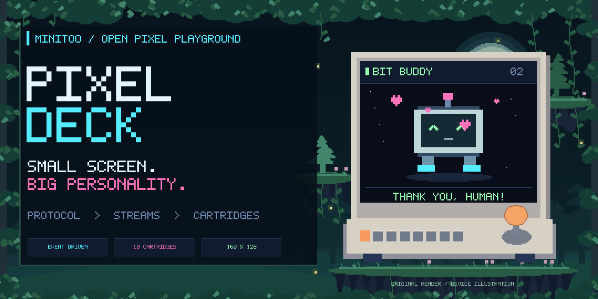</p>

<p align="center"><strong>A tiny screen with a proper software stack.</strong><br>
Protocol tools · independent streams · sixteen original pixel cartridges<br>
Python 3.10+ · Windows hardware backend · MIT · v0.5.0</p>

MiniToo Pixeldeck is an independent, unofficial reverse-engineering toolkit for the **Divoom MiniToo**. Send images, build interactive pixel scenes, inspect the protocol, or use the display as a miniature system monitor. No firmware replacement. No cloud account. Importing the package never connects a device.

```text
PIXELDECK / DESK INSTRUMENTS
  CANVAS       160 x 128 RGB
  CARTRIDGES   16 demos
  INPUT        callbacks + local event streams
  OUTPUT       newest frame wins
  FIRST BOOT   preview / no device required
```

| 01 / ENGINE ROOM | 02 / POWER ON | 03 / CARTRIDGE SHELF |
|:--|:--|:--|
| [Architecture](#architecture) · [Protocol](docs/protocol.md) | [Use it](#use-it) · [中文上手](docs/quickstart.zh-CN.md) | [Live gallery](#insert-a-cartridge) · [Make your own](docs/extending.md) |

Watch network traffic, time a focus session, or follow a build from the desk. Each cartridge uses the same rendering and event APIs.

## Architecture

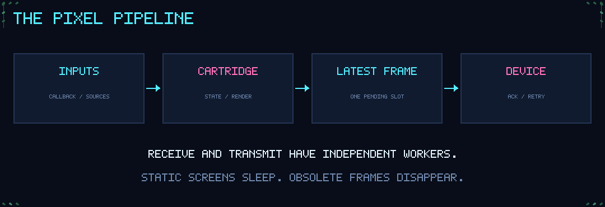

```text
src/pixeldeck/
  protocol.py     Pure framing, incremental decode, image fitting, clip encoding
  driver.py       RFCOMM transactions, independent RX, deadlines and retransmission
  engine.py       One display writer, latest-frame mailbox, deduplication, reconnect
  inputs.py       WinRT callback stream and bounded JSONL notification input
  deck.py         Pure cartridge navigation; no GUI or Bluetooth dependency
  demos/          Stateful renderers with explicit time-event scheduling
  pixels.py       Original pixel lettering and drawing primitives
  telemetry.py    On-demand CPU / memory measurements
  sources.py      Visible-source subscriptions and isolated host measurement worker
  app.py          Desktop preview, input routing, lifecycle and local stop control
  native/         Rebuildable Windows media-event bridge
```

**Input is event-driven.** Windows media callbacks write directly into a pipe; the receiver blocks until data arrives. Notifications arrive as JSONL pushes. Neither path scans a file or periodically asks whether something changed.

**Animation uses deadlines.** A cartridge requests its next meaningful tick. Static screens request none. Host measurements run in a separate worker only for the visible, unfrozen cartridge. A paused scene cancels its animation timer; data collection never lives inside a renderer.

**The screen keeps up with the present.** There is one frame in transit and at most one pending frame. A newer state replaces an obsolete pending frame. Identical pixels are not uploaded again. Input handling does not wait for image transmission; a frame already in transit must still finish or time out.

The hardware paths are different: image packets use **Classic Bluetooth RFCOMM channel 1**; supported physical inputs currently use a **Windows AVRCP media session**. Independent workers do not create independent radio bandwidth. The input session uses muted audio on the configured device endpoint and can receive system media keys.

| Layer | Extension seam | Hardware required? |
|---|---|---|
| Protocol | `packet`, `Decoder`, `jpeg_clip`, `upload` | No |
| Driver | `MiniToo(config, socket_factory=...)` | Only for a real socket |
| Output | `FramePump(sink_factory)`; sink implements `show` / `close` | No |
| Cartridge | `render`, `handle`, `next_delay` | No |
| Data source | Declare `sources` and `source_interval`; receive typed events | No |
| Input | Push normalized events, notices or build progress | No |

See [design and resource bounds](docs/architecture.md), [API recipes](docs/extending.md), and the [capability-to-demo map](docs/capabilities.md).

## Use it

### 1. Preview first

From a source checkout:

```shell
python -m pip install -e .
pixeldeck doctor
pixeldeck list
pixeldeck run buddy
```

Or, with Pillow already installed, use `python run.py` instead of `pixeldeck`. The desktop preview needs Tkinter, normally included in python.org Windows installations. Protocol, encoding and headless GIF export do not need Tkinter.

**Left / Right** select a cartridge, or a tile inside Dashboard. **Enter / Space** activates the current item. **Esc** goes back; **Ctrl+Q** exits. **R** resets Stopwatch, Pomodoro and Breath Loop. The dropdown and on-screen buttons work too. A session defaults to ten minutes; `--duration 0` disables the time limit.

The window always shows its **PREVIEW** or **LIVE** mode. Activate operates the selected demo; it does not enable Bluetooth output. Pairing the device in Windows also does not start frame transmission.

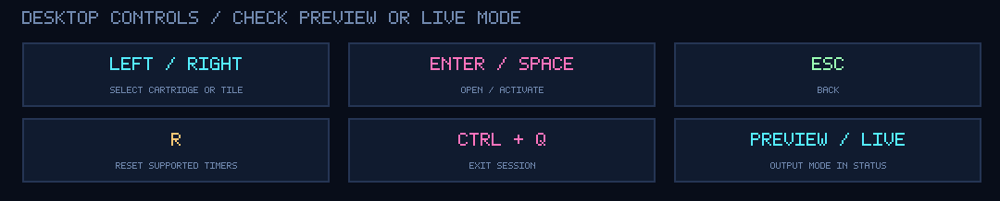

For real network counters and battery information, install the optional telemetry dependency:

```shell
python -m pip install -e ".[telemetry]"
pixeldeck run network
```

The clock and storage monitor use the standard library. Unavailable metrics are labeled unavailable; missing battery hardware is not replaced with a made-up percentage. Network figures are aggregate interface traffic, not an Internet speed test.

### 2. Connect a MiniToo

Pair the device in Windows Bluetooth settings. Let the phone release its display-control connection. Replace the example address with your own paired device address:

```shell
pixeldeck configure --address AA:BB:CC:DD:EE:FF --endpoint MiniToo
pixeldeck run dashboard --send
```

`configure` writes only to your local `~/.pixeldeck/device.json`. To isolate a session, set `PIXELDECK_HOME` to a private directory. The example configuration in this repository contains no device identity.

For the device's supported media buttons:

```shell
pixeldeck build-input
pixeldeck run dashboard --send --media
```

The bridge is compiled locally from included C# source. It requires Windows PowerShell, the .NET Framework compiler and Windows WinMetadata. The configured endpoint must match exactly one speaker output. It provides three actions: previous, next and activate (both Play and Pause). Dashboard uses them to select and open tiles; other cartridges use previous/next for navigation. Joystick up/down/center and a device Back key are **not** exposed by this toolkit. Some native device modes consume buttons locally.

| Start mode | Display output | Input |
|---|---|---|
| `pixeldeck run dashboard` | Desktop preview only | Desktop controls |
| `pixeldeck run dashboard --send` | Desktop + Bluetooth display | Desktop controls |
| `pixeldeck run dashboard --send --media` | Desktop + Bluetooth display | Desktop + supported media actions |

Display and input have separate status lines. A successful frame upload does not confirm that the media input session is ready. Bluetooth compatibility depends on Classic RFCOMM and the Windows media-profile path, not the adapter's version label alone; see [compatibility and diagnostics](docs/usage.md#bluetooth-compatibility).

On Windows, [launch.ps1](launch.ps1) offers the same three modes. It defaults to Preview and does not install dependencies automatically:

```powershell
powershell -NoProfile -ExecutionPolicy Bypass -File .\launch.ps1 -Mode Interactive -Demo dashboard
```

Use `-Mode Display` for output without device input, or add `-Check` for redacted diagnostics without connecting. [Launcher options →](docs/usage.md#windows-launcher)

### 3. Send, export and push

```shell
pixeldeck image my-art.png --send
pixeldeck export orbit --output orbit.gif
pixeldeck run signal --stdin
```

Pipe a producer into Signal Inbox:

```shell
python examples/push_notice.py | pixeldeck run signal --stdin
```

Each incoming line is a small typed event. Use `{"type":"notice","text":"BUILD COMPLETE. TIME FOR TEA."}` for Signal, or feed Build Beacon an event such as:

```json
{"type":"build","project":"PIXEL PROJECT","state":"running","progress":64,"step":"RUNNING CHECKS"}
```

Run `pixeldeck run build --stdin` and let your own producer report state changes. Neither schema executes commands or integrates with a hosted service. [Full CLI and configuration reference →](docs/usage.md)

## Insert a cartridge

These are **real program renders**, not concept art. Gallery GIFs are exported offline at 8 FPS. Device animation requests 3 FPS by default and is limited by actual Bluetooth throughput. Monitor values below are synthetic fixtures. The device illustration is original stylized artwork, not a product photo.

| What belongs on your desk? | Start here |
|---|---|
| A small system instrument | `dashboard` · `pulse` · `network` · `storage` · `power` |
| Time with a physical presence | `clock` · `stopwatch` · `pomodoro` · `focus` · `breathe` |
| A glanceable event signal | `build` · `signal` |
| Animated pixel scenes | `buddy` · `rain` · `orbit` |
| A clear input diagnostic | `buttons` |

Every preview is reproducible: [cartridge registry](src/pixeldeck/demos/__init__.py) → [export code](src/pixeldeck/export.py) → [gallery builder](tools/build_gallery.py). [Full contact sheet →](docs/assets/gallery.png)

### Dashboard

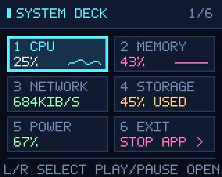

CPU, memory, network, storage and power share one overview, with a sixth **EXIT** tile. Left / Right moves the selection; Activate opens a metric. In detail view, Left / Right changes metrics and Activate or desktop Back / Esc returns to the grid. On the MiniToo, **Play / Pause opens and returns**; joystick up/down and the original Back key are unsupported. Desktop Back / Esc from the grid returns to Bit Buddy.

```shell
pixeldeck run dashboard --send --media
```

The EXIT tile, desktop Exit button or Ctrl+Q closes Pixeldeck and releases its connections. The device keeps the last displayed frame; exit does not restore its native menu. The demo also works in preview mode without either flag.

### System monitors and desk tools

Individual cartridges for monitoring, timing and pushed events. [View the utility collection together →](docs/assets/useful-demos.png)

| Net Scope | Volume Vault | Power Cell |
|:--:|:--:|:--:|
| 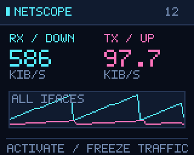 | 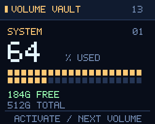 | 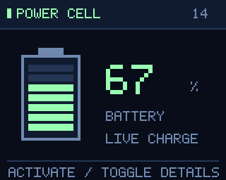 |
| Aggregate receive and transmit rates.<br>Activate freezes RX / TX. | Free space at a glance.<br>Activate selects another volume. | Battery level and power details.<br>Shows NO BATTERY when none is present. |
| `pixeldeck run network` | `pixeldeck run storage` | `pixeldeck run power` |

| Neon Clock | Stopwatch | Pomodoro |
|:--:|:--:|:--:|
| 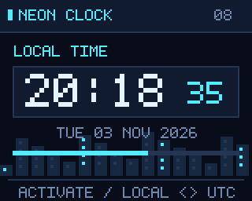 | 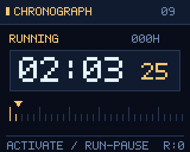 | 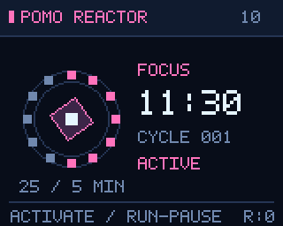 |
| Local time and UTC.<br>Activate switches the time basis. | Elapsed time for tasks and experiments.<br>Activate starts / pauses; desktop R resets. | 25 minutes of focus, 5 minutes of rest.<br>Activate starts / pauses; desktop R resets. |
| `pixeldeck run clock` | `pixeldeck run stopwatch` | `pixeldeck run pomodoro` |

| Breath Loop | Build Beacon |
|:--:|:--:|
| 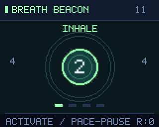 | 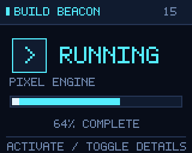 |
| A 4–4–4–4 pacing loop.<br>Activate starts / pauses; desktop R resets. | Build progress and results.<br>JSONL pushes progress; activate changes the view. |
| `pixeldeck run breathe` | `pixeldeck run build --stdin` |

<details>
<summary><strong>Three ways to use the desk tools</strong></summary>

**During a download:** open Net Scope, freeze a sample with Activate, then switch to Volume Vault to check capacity. Neither cartridge uploads host measurements or actively probes the network.

**During focused work:** start Pomodoro, switch away while it keeps elapsed time, and return to the current phase. Use Stopwatch for an open-ended task. Desktop R starts those timers over.

**During a build:** let your build script push `running`, progress and a final `passed` or `failed` event into Build Beacon. The screen reports what the producer sends; it never launches or cancels the build.

</details>

### Animated cartridges and input diagnostics

| Pulse | Bit Buddy | Neon Rain |
|:--:|:--:|:--:|
| 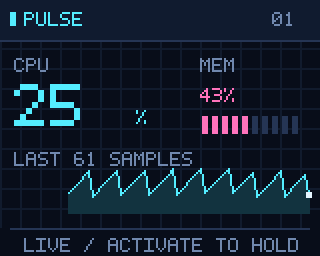 | 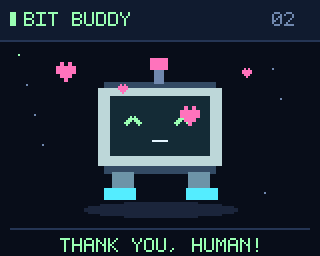 | 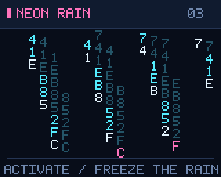 |
| CPU waveform + memory bars.<br>Activate to freeze. | An animated CRT companion.<br>Activate to send a heart. | Falling cyan and magenta characters.<br>Activate to suspend the rain. |
| `pixeldeck run pulse` | `pixeldeck run buddy` | `pixeldeck run rain` |

| Orbital | Focus Foundry | Button Lab |
|:--:|:--:|:--:|
| 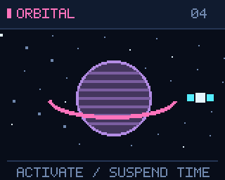 | 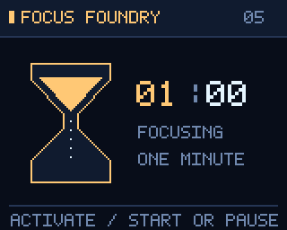 | 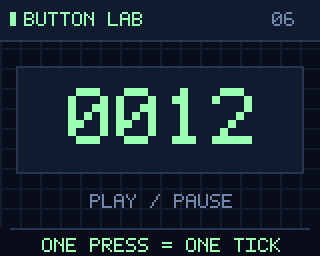 |
| A ringed planet and orbiting satellite.<br>Activate to pause. | A one-minute pixel hourglass.<br>Activate to start / pause. | A counter for each activation.<br>A static input diagnostic. |
| `pixeldeck run orbit` | `pixeldeck run focus` | `pixeldeck run buttons` |

### Signal Inbox

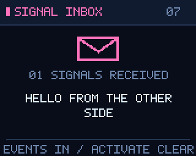

Build events, home automation, chat notices, creative experiments: bring your own producer. Signal keeps the last eight notices and updates only when an event arrives. Activate clears the inbox. It is a generic local interface with no service integration or embedded credentials.

## Write a cartridge

A cartridge renders one `160 × 128` RGB image. It knows nothing about Bluetooth:

```python
from pixeldeck.demos import Demo
from pixeldeck.pixels import Canvas, CYAN

class Hello(Demo):
    key = "hello"
    def render(self, now):
        canvas = Canvas()
        canvas.text(80, 58, "HELLO, PIXELS", CYAN, center=True)
        return canvas.image
```

For an interactive version and registration, run [custom_cartridge.py](examples/custom_cartridge.py). For a headless encoding walkthrough, run [protocol_lab.py](examples/protocol_lab.py). Replace the output sink to stream into another device or your own test harness.

## Validation and boundaries

- Offline checks cover framing, fragmented input, ACK loss, retransmission, bounded heartbeats, queue replacement, idle reconnect, utility state machines, data subscriptions, pushed events and hidden GUI shutdown. The current counts and results are recorded in [validation](docs/validation.md).
- A preceding hardware session using the same media-command approach completed **401 acknowledged frames** over about ten minutes, with **296 ms median transfer time**, no logged transfer failures, and user-confirmed single-press counting and timer controls.
- The **0.3.0** driver acknowledged **24 frames across the original seven demo renderers**, with **390.5 ms median transfer time** and no retransmission requests. This earlier display-only check does not certify later cartridges, media input or long runs. ACK latency does not measure the instant pixels become visible. [Validation details →](docs/validation.md)
- Live uploads do not call gallery or firmware-write commands. Firmware-side memory/storage behavior, overnight endurance and simultaneous phone music remain unverified.
- Windows is the bundled hardware backend. Preview/rendering/protocol code is portable. CPU/memory have built-in Windows and Linux providers; other platforms show unavailable values for those fields. Optional network/battery measurements depend on what the host OS and psutil report. A supported API is not a claim that every platform has been exercised.

## Development

Raw joystick work is tracked separately in [input investigation](docs/input-research.md). Experimental receivers capture evidence; they do not add unverified Up/Down/Back mappings to normal demos.

```shell
python -m unittest discover -s tests -v
python tools/build_gallery.py
python tools/release.py
```

The release tool includes an explicit public file allowlist, checks relative Markdown links, scans for local paths/device identifiers/secrets, and writes a ZIP plus SHA-256 checksum. It does not publish anything. CI runs offline tests and builds a wheel on Windows and Linux.

<details>
<summary><strong>Rebuild the visual documentation</strong></summary>

`tools/build_gallery.py` generates the hero, control strip, architecture drawing, full contact sheet, utility contact sheet and every cartridge PNG/GIF from source. The monitor fixtures are synthetic and carry no host identity. No image-generation service, paid font or downloaded sprite pack is needed to reproduce the gallery.

</details>

## Credits

Protocol research: [bugzmanov/divoom-minitoo](https://github.com/bugzmanov/divoom-minitoo), [alvinunreal/divoom-minitoo-osx](https://github.com/alvinunreal/divoom-minitoo-osx), and [lewilou22/divoom-minitoo-tools](https://github.com/lewilou22/divoom-minitoo-tools). Visual inspiration: [RoboEyes](https://github.com/FluxGarage/RoboEyes), [PICO-8 particles](https://mboffin.itch.io/pico-8-particles), and the [MiniToo industrial design](https://divoom.com/products/minitoo/).

The protocol module is an independent implementation of documented fields and observed replies. Pixel lettering, sprites, animations and device illustrations are original procedural artwork. No third-party sprite pack or upstream source file is bundled. [Sources and attribution →](docs/sources.md)

README layout references: [Gum](https://github.com/charmbracelet/gum), [VHS](https://github.com/charmbracelet/vhs), and [Starship](https://github.com/starship/starship). [Design notes →](docs/readme-design.md)

MIT for this project's code and artwork. Divoom and MiniToo are their owners' marks. This is an unofficial community project.
