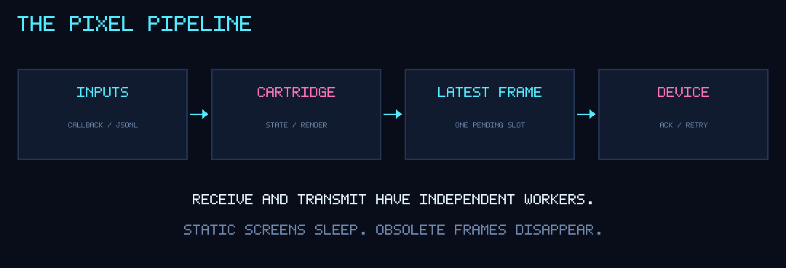

# Architecture / less waiting, more pixels

## Ownership

One UI thread owns cartridge state and renders pixels. External input threads push events and wake that thread with a Tk event. A bounded priority queue gives buttons precedence over ordinary telemetry and status events. Rendering never calls the Bluetooth driver.

`FramePump` owns the output worker and sink. A producer copies a frame into a one-item mailbox; the worker blocks until that mailbox changes. The sink does complete transactions. `MiniToo` has a separate reader that blocks on `recv()` even while the display is idle, consuming heartbeats and collecting transaction responses.

The Windows bridge receives Next/Previous/Play/Pause through WinRT callbacks and writes JSON lines immediately. Its reader blocks on stdout. Explicit media Play/Pause state changes preserve alternating remote commands; each callback produces one activation.

## Scheduling

There is no fixed render loop for static screens. `next_delay(now)` returns a deadline or `None`. Animated cartridges request roughly three ticks per second; Pulse requests one sample per second. Button Lab and Signal request no idle timer. Pausing Rain or Orbital cancels animation scheduling.

Focus stores a monotonic start time and remaining duration. Leaving its page stops animation work; elapsed time still counts, and the correct state is reconciled when the page becomes visible. There is currently no hidden-page completion notification.

Output packet pacing, one-shot transmission deadlines and bounded reconnect backoff are intentional waits. They do not poll for button events. Multiple Bluetooth profiles still share hardware resources.

## Bounds

| Resource | Limit |
|---|---:|
| Pending image | 1, replaced by the newest state |
| In-flight image | 1 |
| Button queue | 32 |
| Other event queue | 128 |
| CPU history | 61 samples |
| Notifications | 8 × 80 characters |
| JSONL line | 4 KB characters |
| Receive buffer | 64 KB |
| Active response queue | 64 packets |
| Diagnostic packet trace | 32 packets |
| Timing window | 256 completed sends |
| Live encoded payload | 16,000 bytes |
| Local logs | 1 MB current + 2 backups |

An event queue overflow is logged and that new event is rejected; this is not a lossless distributed broker. Producers should honor the boolean result of `Application.post`. The current CLI producer has no replay protocol. The latest-frame mailbox deliberately coalesces pictures, never application button state.

## Connection lifecycle

The device name is checked against the configured paired address before the built-in Windows backend connects. A file lock prevents concurrent Pixeldeck senders that share the same runtime directory. Other software or a differently configured runtime directory can still compete for the device.

Each upload waits for READY, sends 256-byte chunks, handles chunk requests and waits for completion. A transaction watchdog closes a blocked connection. `FramePump` retries a finite number of times, chooses the latest state after a failure and pauses output when the budget is exhausted. Idle disconnection wakes the pump through the reader callback.

Stopping closes the output socket, stops the media bridge through stdin, releases local control IPC, joins the output worker and releases the instance lock. Nothing is saved to the device's gallery as an exit action.

## Porting

The protocol and cartridges depend only on Python and Pillow. Implement a socket-like object with `connect`, `settimeout`, `sendall`, `recv`, `shutdown`, and `close`, and inject its factory into `MiniToo`. A different display can instead implement `show(image)` returning a report containing `transfer_ms`, `close()`, and an optional `healthy` property, then use `FramePump` directly. GUI and WinRT code do not belong in either adapter.
