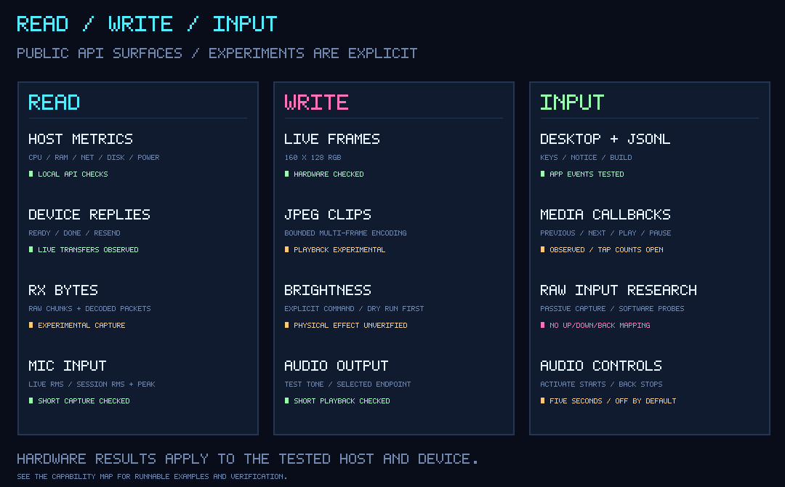

# Capability map

Each row names a runnable demo, CLI operation or diagnostic. Hardware observations and offline simulations are listed separately; an encoded command is not proof of its physical effect.

| Implemented capability | Demo / recipe | Verification |
|---|---|---|
| Still RGB image upload | `image`, Link Lab PATTERN, `examples/device_lab.py` | Protocol simulation; recorded live display sessions |
| Lossless RGB/Zstandard encoding | `image --codec zstd`, `run --codec zstd` | Pixel round-trip and bounds tests; controlled hardware transfer observations |
| Bounded local codec selection | `run --codec auto`, `examples/device_lab.py --operation still --codec auto` | Chooses the smaller available payload; budget/dependency tests; no device capability negotiation |
| Repeated live frames | Dashboard, Pulse, Bit Buddy, Neon Rain, Orbital | Latest-frame pipeline tests; Dashboard hardware session with 583 ACKs |
| Static-frame suppression | Button Lab, paused Rain | Automatic check |
| Input while frames transmit | Every interactive cartridge | Blocked-sink concurrency test; predecessor media-input session |
| Next / Previous / Play / Pause | Navigation + Button Lab + Focus | Callbacks observed in music mode; paired/missing tap callbacks remain unresolved |
| Input backend selection and activation-burst guard | Button Lab with `--input-backend auto`, `winrt` or `legacy` | First activation immediate; 250 ms burst coalescing; exact physical tap counts remain unverified |
| Contextual selection, detail and return | Dashboard | Grid/detail state tests; three normalized media actions |
| Explicit session exit | Dashboard EXIT, desktop Exit / Ctrl+Q | Host cleanup path; last device frame remains |
| Separate mode and connection status | Desktop host | Preview/live startup checks; independent display/input status |
| Transfer/input snapshots without upload feedback | Link Lab (`link`) | Observations collect silently; explicit snapshot refresh; current ACK appears later |
| Explicit audio endpoint discovery | `pixeldeck audio-devices` | OS enumeration only; no stream or physical-effect verification |
| Short tone playback | Audio Lab SPEAKER | Repeated tones heard on the tested Windows setup; full live scope |
| Compact instantaneous microphone RMS | Audio Lab MIC | Physical capture observed; 50 ms windows, ≤20 Hz reports; device display remains slower |
| Session RMS, peak and frame coverage | Audio Lab SESSION | Weighted metering, final partial windows and drop-count tests; retained results after stop |
| Independent playback and capture | Audio Lab DUPLEX | Concurrent tone and microphone operation observed; no mic loopback or audio files |
| Monotonic time events | Focus Foundry | Elapsed-time and pause/resume checks |
| CPU and memory | Pulse | Windows provider; Linux implementation not host-tested |
| Passive network counters | Net Scope | Optional source, bounded history and freeze behavior checks |
| Volume capacity | Volume Vault | Host source plus pure-renderer fixture checks |
| Battery and external power | Power Cell | Optional source; unavailable/no-battery states are explicit |
| Local / UTC wall clock | Neon Clock | Typed wall-clock events; renderer does not read the system clock |
| Start / pause / reset timing | Stopwatch | Monotonic elapsed-time checks |
| Focus / break cycle | Pomodoro | Pause/resume and phase-boundary checks |
| Four-phase pacing | Breath Loop | Deterministic phase and paused-state checks |
| Visible-source subscriptions | Monitoring cartridges | Sampling runs outside rendering and ends when no longer needed |
| Bounded JSONL push input | Signal Inbox, Build Beacon | Notice/build schema checks; no execution path |
| Frame fitting / alpha | `image` | Automated alpha-compositing check |
| JPEG multi-frame encoding | `clip`, `examples/device_lab.py --operation clip`, `protocol_lab.py` | Encoding and bounds checks; device playback experimental |
| Packet framing / fragmentation | `protocol_lab.py` | Golden bytes and corrupted packet tests |
| ACK, resend and timeout | `python examples/driver_lab.py` | Simulated fragmented READY, resend and missing-response cases |
| Encoding, transfer and frame-age diagnostics | Host logs, Link Lab, `examples/device_lab.py` | Separate encoding/ACK stages and host submit-to-ACK age; no acoustic-latency claim |
| Idle heartbeat draining | `python examples/driver_lab.py` | Simulated heartbeat stream, bounded trace; no hardware input inference |
| Replaceable sink, deduplication and idle recovery | `python examples/pipeline_lab.py` | Blocked first frame, newest pending frame, simulated disconnect and cleanup |
| Brightness command | `brightness`, `examples/device_lab.py --operation brightness` | Simulated matching ACK; physical effect unverified; dry run by default |
| Stop and release | Window close / `stop` | Hidden GUI and local IPC integration check |
| Offline art export | `export`, `build_gallery.py` | Generated gallery inspected locally |
| Raw receive and decoded packet observation | `python -m pixeldeck.experimental.input_probe` | Fake-frame tests preserve raw bytes and F7 heartbeats; receive-only device captures |
| Unknown framing on advertised channel 10 | `python -m pixeldeck.experimental.input_probe --channel 10` | Raw mode bypasses decoding; connection observed, zero bytes in the recorded music-mode trial |
| Bounded capture, operator markers and early stop | `python -m pixeldeck.experimental.input_probe`; `mark LABEL` / `stop` on stdin | Queue/log limits and cleanup tests; console/pipe input checks |
| Python media commands and raw SMTC observation | `python -m pixeldeck.experimental.media_probe` | Experimental receiver; confirmed physical callbacks with unresolved tap counts |
| Software callback verification | `python -m pixeldeck.experimental.media_send --send --actions next previous` | Exact-title/identity checks; accepted requests must be compared with receiver callbacks |

Audio Lab, Link Lab, Dashboard and the eight 0.4.0 utility cartridges have separate validation from the earlier seven-cartridge hardware run. See [validation](validation.md) for test results, device evidence and platform coverage.

The [input guide](input-research.md#experimental-tools) covers experimental probe dependencies and commands. CoreAudio volume changes were observed during research, but no general volume-input adapter is part of the package.

Not implemented: firmware flashing, factory reset, persistent photo storage, custom watchface installation, general-purpose audio playback control, BLE, arbitrary joystick events, undocumented raw command execution, automatic device discovery, or cloud services. The synthetic media sender is restricted to its matching diagnostic session.
