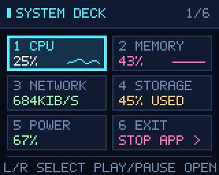

# MiniToo Pixeldeck 中文快速上手

<p align="center"></p>

这是独立的 MiniToo 像素开发工具。电脑运行程序，通过蓝牙发送画面；没有替换设备固件。代码、主文档和像素界面以英文为主。

## 架构

协议编解码 → 蓝牙驱动 → 最新帧发送器 → 可扩展 demo。输入通过回调和管道推送，与传图分开。静止页面不重复上传，暂停动画会取消定时事件。动画和 CPU 数据仍需要明确的时间事件，但不会通过轮询文件寻找按键。

主机数据读取由独立的工作线程负责，只为当前可见、未冻结的页面采样。切页后过期的读取结果会被丢弃，渲染函数不读磁盘、不访问网络。新增的网络页面只是读取本机接口计数，不发起测速或探测请求。

## 使用

Windows 推荐使用 Python 3.11+，在仓库目录建立独立环境：

```powershell
python -m venv .venv
.\.venv\Scripts\python.exe -m pip install -e ".[telemetry,windows-input,audio,display]"
.\.venv\Scripts\pixeldeck.exe doctor
powershell -NoProfile -ExecutionPolicy Bypass -File .\launch.ps1 -Mode Preview -Demo buddy
```

启动脚本会自动找到 `.venv`。下文命令中的 `python` 和 `pixeldeck` 是简写；未激活环境时，分别使用 `.\.venv\Scripts\python.exe` 和 `.\.venv\Scripts\pixeldeck.exe`。只做跨平台预览时，Python 3.10+ 安装基础包 `python -m pip install -e .` 即可。

默认只预览，不连接设备。窗口会一直显示 PREVIEW 或 LIVE 模式。Activate 只操作当前 demo，不负责连接蓝牙；Windows 显示“已配对”也不代表程序正在传图。

左右方向键切换 demo，在 Dashboard 内则选择监控项目。Enter 或空格操作，Esc / Back 返回，Ctrl+Q / Exit 退出。秒表、番茄钟和 Breath Loop 可在电脑上按 R 重置。也可以用窗口按钮。

上面的完整安装已包含网络和电池数据依赖。基础安装可另外添加：

```shell
python -m pip install -e ".[telemetry]"
pixeldeck run network
```

时钟、计时器和磁盘容量页面不需要这项依赖。缺失的数据会明确显示不可用；没有电池的台式机不会出现虚构的电量。

Windows 配对 MiniToo 后，填写自己的设备地址：

```shell
pixeldeck configure --address AA:BB:CC:DD:EE:FF
pixeldeck run dashboard --send
```

手机需要释放屏幕控制连接。地址只是格式示例，本仓库不含真实设备配置。设置保存在用户目录的 `.pixeldeck` 中；`PIXELDECK_HOME` 可以指定其他私人运行目录。

启用机身媒体按键：

```shell
pixeldeck build-input
pixeldeck run dashboard --send --media
```

默认 `--input-backend auto` 会在 Windows、Python 3.11+ 和匹配的 WinRT 依赖可用时选择 Python WinRT，否则选择旧 C# 后端。也可显式指定 `--input-backend winrt` 或 `--input-backend legacy`。`build-input` 会检查 WinRT 依赖，或编译所选的 C# 后端。运行失败会报告并有限重试，不会静默切换后端。

输入会话使用指定设备上的静音音频。媒体回调映射成“上一个、下一个、操作”。播放／暂停的首个回调立即生效，随后 250 毫秒内的同类回调合并；这不会增加首个动作的等待，但刻意快速连按也可能被合并。已观测到这些媒体回调，但一次物理按键与一次应用动作的一一对应仍未完全验证。

媒体按键依赖设备的 **Bluetooth Music 播放页面**；原机菜单会自行处理导航。摇杆上、下、中央按下和原机返回键没有应用映射。手机放歌与电脑显示并行尚未验证。

| 启动方式 | 画面 | 输入 |
|---|---|---|
| `pixeldeck run dashboard` | 只在电脑预览 | 电脑键盘和窗口按钮 |
| `pixeldeck run dashboard --send` | 电脑预览，同时蓝牙传图 | 电脑键盘和窗口按钮 |
| `pixeldeck run dashboard --send --media` | 电脑预览，同时蓝牙传图 | 电脑操作，加上已支持的机身媒体动作 |

传图状态和输入状态分别显示。传图 ACK 成功不能证明机身按键已经接通。可以用 `pixeldeck run buttons --send --media` 观察实际收到的动作数量，再验收普通单击的行为。

Windows 也可使用仓库内的启动脚本：

```powershell
powershell -NoProfile -ExecutionPolicy Bypass -File .\launch.ps1 -Mode Interactive -Demo dashboard
```

`-Mode Preview` 只预览，`-Mode Display` 只增加传图，`-Mode Interactive` 同时接入媒体按键。`-InputBackend Auto|WinRT|Legacy` 可选择输入后端。`-Codec jpeg|zstd|auto` 和 `-ChunkDelayMs N`（0–100）只覆盖本次运行的编码和分块间隔；省略时沿用配置，默认 JPEG / 10 毫秒。默认是 Preview / dashboard；脚本不会自动安装依赖。加 `-Check` 只检查脱敏后的本地配置和依赖，不连接设备。其他参数见 [启动器说明](usage.md#windows-launcher)。

蓝牙兼容性需要看 Classic RFCOMM、Windows 媒体配置和驱动是否可用，不能仅凭“蓝牙 4.x / 5.x”判断。当前真机证据只覆盖记录中的电脑与设备组合；[兼容性说明及微软资料](usage.md#bluetooth-compatibility) 列出了具体要求。`pixeldeck doctor` 不会连接设备，因此不能代替实际传图和按键验证。

## Dashboard 操作



总览有 CPU、MEMORY、NETWORK、STORAGE、POWER 和 EXIT 六格。左右选择，Activate 打开详情；详情中左右切换指标，再按 Activate 或电脑 Back / Esc 回总览。机身用**播放／暂停键打开和返回**，不支持摇杆上下和原机返回键。总览里按电脑 Back / Esc 回到 Bit Buddy。

选中 EXIT 后操作，或用窗口 Exit / Ctrl+Q，会关闭电脑端程序并释放连接。设备保留最后一帧，不会自动跳回原机菜单。这些选择、放大和返回操作也能通过已支持的三种媒体动作完成。

## 十八张小卡带

| 名称 | 内容 | 操作 |
|---|---|---|
| dashboard | CPU、内存、网络、磁盘、电源总览 | 选择、放大、返回，EXIT 退出 |
| link | 传输 ACK、输入计数、编号测试画面 | 左右选择面板，操作刷新快照，电脑 Back 返回 |
| audio | 扬声器测试音、麦克风电平、双工测试 | 空闲时左右选模式，操作开始五秒测试；运行中操作／Back 停止 |
| pulse | CPU 曲线、内存用量 | 冻结／恢复 |
| buddy | 像素小伙伴 | 打招呼、冒爱心 |
| rain | 霓虹字符雨 | 暂停／继续 |
| orbit | 星球、卫星和星空 | 暂停／继续 |
| focus | 一分钟像素沙漏 | 开始／暂停 |
| buttons | 按键计数诊断 | 每次加一 |
| signal | JSONL 推送通知 | 清空通知 |
| network | 本机网络接口的聚合接收／发送速率 | 冻结／恢复 |
| storage | 本地磁盘容量和剩余空间 | 切换磁盘 |
| power | 电池和外接电源状态 | 切换详情 |
| clock | 本地时间／UTC 时钟 | 切换时间基准 |
| stopwatch | 开放式秒表 | 开始／暂停，电脑 R 重置 |
| pomodoro | 25 分钟专注／5 分钟休息 | 开始／暂停，电脑 R 重置 |
| breathe | 4–4–4–4 节奏动画 | 开始／暂停，电脑 R 重置 |
| build | 推送式任务／构建进度和结果 | 切换详情 |

图形预览见 [主 README](../README.md) 和 [新增实用工具总览](assets/useful-demos.png)。文档 GIF 是离线渲染，数据采用示例值，不代表蓝牙能达到同样帧率。硬件上传跟不上时会保留最新画面，而不是补播旧动画。

Link Lab 会记录传输和输入，但不会因为收到 ACK 自动刷新并再次传图。按操作键后才更新快照，因此当前画面的 ACK 要到下一次快照才会显示。计数反映电脑收到的事件，不等于原始物理按键数。

不连接设备也能运行底层演示：

```shell
python examples/device_lab.py
python examples/driver_lab.py
python examples/pipeline_lab.py
```

第一个默认只生成静态帧、多帧 clip 和亮度命令的发送计划；后两个分别模拟驱动应答／重传／超时，以及最新帧替换／去重／重连。只有 `device_lab.py` 显式加 `--send` 才会连接设备，例如 `--operation still --send`。clip 和亮度的物理效果仍需验证；亮度不会自动恢复，参数见 [使用说明](usage.md#device-write-lab)。

默认显示编码仍为 JPEG。完整安装中的 `display` 依赖可启用无损 Zstandard：`pixeldeck run dashboard --send --codec auto` 会在发送前选择较小且不超过 16,000 字节的可用编码，不会探测设备是否支持它，也不会在传输失败后切换格式重发。`python examples/device_lab.py --operation still --codec auto` 可以离线查看编码、大小和分块数。多帧 `clip` 保持 JPEG；更多选项见 [编码说明](usage.md#display-encoding)。

## Audio Lab

```shell
pixeldeck audio-devices --match MiniToo
pixeldeck run audio --audio --audio-input INPUT_ID --audio-output OUTPUT_ID
```

把 `INPUT_ID`、`OUTPUT_ID` 换成 `audio-devices` 列出的整数编号；不加 `--match` 可查看全部设备。SPEAKER 只需要输出，MIC 只需要输入，DUPLEX 需要两者。默认 `run audio` 不启用音频；即使加了 `--audio`，也要按操作键才会开始五秒测试。

MIC 和 DUPLEX 运行时显示精简的瞬时 RMS 数值和大音量条，数值按整数 dBFS 显示，音量条范围为 -60..0 dBFS；没有峰值保持或输入增益。实际静音显示 -INF，缺失数据保留等待状态。DUPLEX 同时播放独立测试音，不把麦克风回放到扬声器。SPEAKER 保留完整波形和峰值视图。

计量使用四个预分配的 50 毫秒缓冲槽，最多每秒报告 20 次；这不代表设备能每秒显示 20 帧。停止后的 SESSION 保留整段 RMS、峰值、最近 20 个报告窗口的峰值，以及已计量／丢弃帧数。运行中操作／电脑 Back 可停止，离开页面也会停止。缺少所选模式需要的输入或输出时会显示错误。加 `--send` 可把页面传到 MiniToo。

程序不保存音频文件；退出时 `latest.png` 只保留最后的显示画面。短时间实测已确认扬声器、麦克风和双工在记录中的 Windows 设备组合上工作，但设备画面仍有可感延迟，不能视为已解决。文档动画使用合成数据；具体测量和未验证范围见 [验证记录](validation.md)。

向 Build Beacon 推送一行 JSON 即可更新状态：

```json
{"type":"build","project":"PIXEL PROJECT","state":"running","progress":64,"step":"RUNNING CHECKS"}
```

启动入口是 `pixeldeck run build --stdin`。实际任务由你自己的程序执行，显示端只接收状态，不执行命令、不扫描日志。支持 idle、running、passed、failed 四种状态；进度未知时可填 null。

网络显示的是接口字节速率，不等同于互联网测速；磁盘显示的是容量，不是读写速度。Breath Loop 用动画提示节奏。新增页面与旧版真机记录的验证范围见 [验证说明](validation.md)。

关闭窗口或运行 `pixeldeck stop` 停止。默认十分钟自动退出；`--duration 0` 可以取消时限，但设备长时间稳定性仍待验证。亮度控制和多帧 clip 属于实验接口，不会由普通 demo 自动调用。
